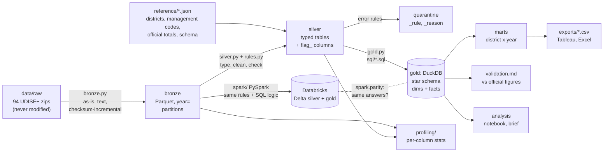
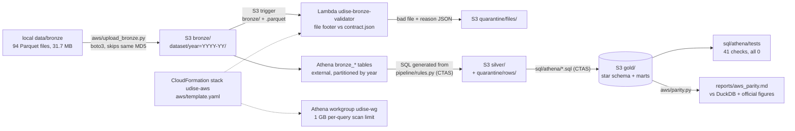
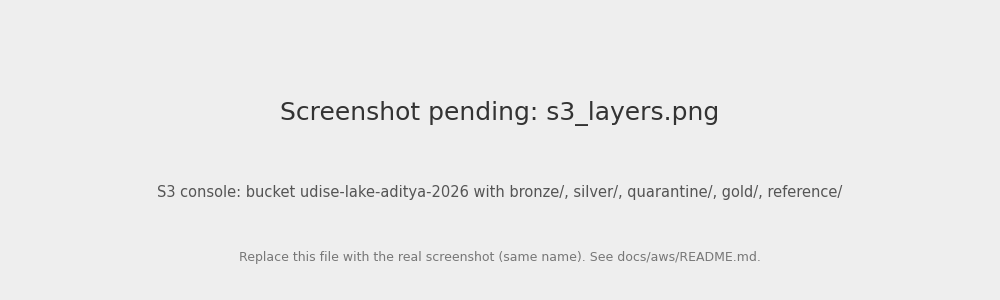
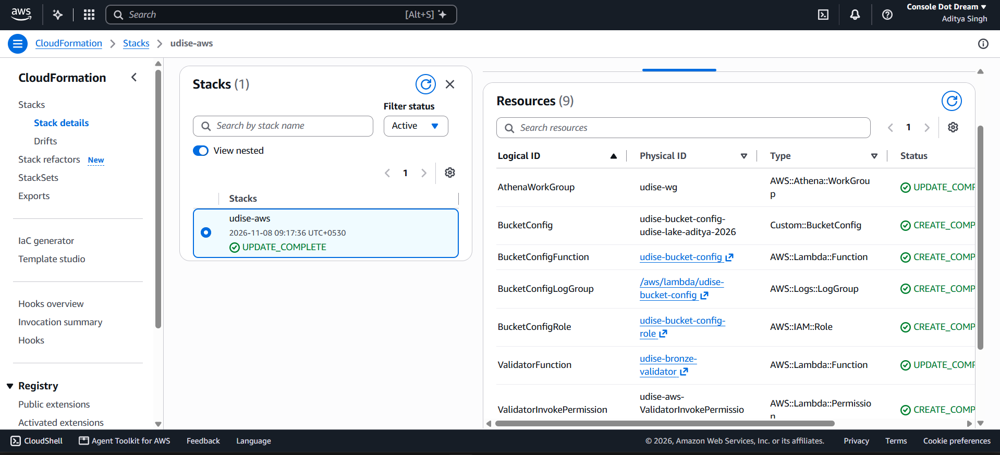
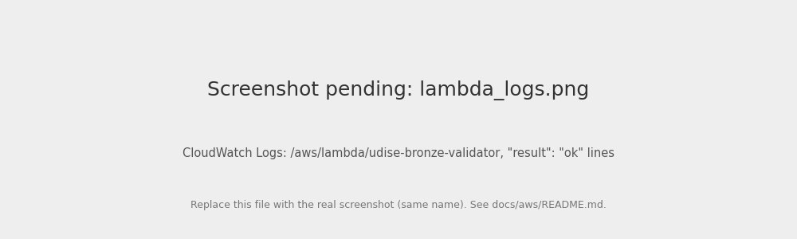
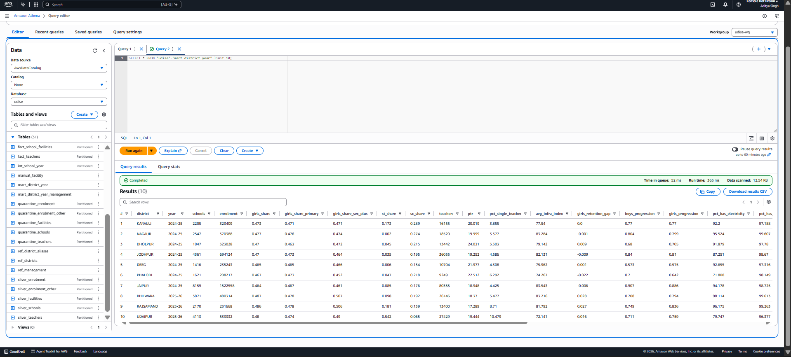
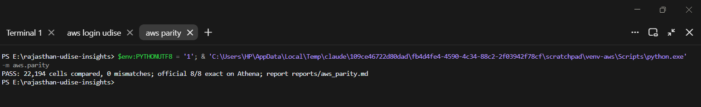
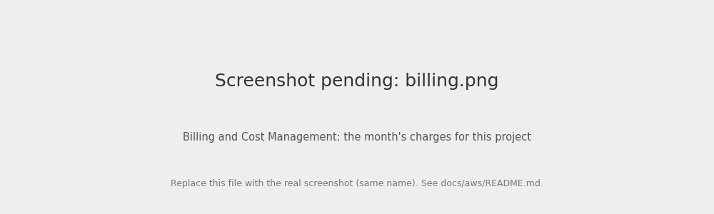

# Rajasthan School Education Insights (UDISE+)


A data pipeline and analysis of school infrastructure, teachers and enrolment in all
41 districts of Rajasthan, built from UDISE+ school-level microdata for 2024-25 and 2025-26.

**Core question:** Which districts are falling behind on school infrastructure and
teachers, and is that linked to girls staying in secondary school?

**Live dashboard:** [Rajasthan School Education Insights on Tableau Public](https://public.tableau.com/app/profile/aditya.chauhan4106/viz/RajasthanSchoolEducationInsightsUDISE2024-26/Overview)
(Overview, Girls in secondary, Teachers; district aggregates only).

Two parts:
1. **Data engineering:** an ELT pipeline (raw zips -> bronze -> silver -> gold), with profiling,
   quality rules and quarantine, a DuckDB star schema with an SCD Type 2 school dimension,
   SQL data marts, validation against official figures, tests and CI.
2. **Analysis:** district rankings, girls' secondary enrolment, a school-level regression and
   year-on-year changes, read from the gold marts (`notebooks/`, `docs/policy_brief.md`).
3. **Statistical analysis & regression modelling:** EDA, preprocessing, feature engineering,
   correlation analysis, hypothesis tests, linear and logistic regression with assumption and
   overfitting checks (`notebooks/statistical_analysis.ipynb`).

## Architecture



| Layer | What it holds | Last full run |
|---|---|---|
| raw | 94 zips as downloaded from the portal (CSV inside) | 30 MB |
| bronze | one Parquet file per zip, every value as text + load metadata (`_source_file`, `_source_row`, `_run_id`, ...) | 1,720,687 rows, 31.7 MB |
| silver | 5 typed, standardised tables; rows failing an error rule go to quarantine, warnings become `flag_<rule>` columns | 1,707,127 rows; 13,560 quarantined |
| gold | DuckDB star schema: 7 dimensions, 3 facts, 1 intermediate, 2 marts; 33 SQL data tests | `fact_enrolment` 6,403,516 rows |

Every bronze row ends up in silver or in quarantine (checked on every run). All 8 published
2024-25 indicators (schools 1,06,302; teachers 7,92,265; enrolment 1,63,64,187; ...) are
reproduced exactly from gold (`reports/validation.md`).

## How to run

Windows PowerShell, Python 3.13:

```powershell
pip install -r requirements.txt
python run_pipeline.py                 # whole pipeline; unchanged zips are skipped in bronze
python run_pipeline.py --full-refresh  # reload every zip into bronze
python run_pipeline.py --sample        # whole pipeline on synthetic data (outputs in data/sample/)
python run_pipeline.py --delta         # also write silver and gold as Delta Lake tables (data/delta/)
python -m pytest                       # tests (synthetic data; real-data checks run only if gold exists)
python scripts/benchmark.py            # raw CSV vs bronze vs gold timings -> reports/benchmark.md
python scripts/make_data_dictionary.py # docs/data_dictionary.md from the gold database
python -m pipeline.rules               # docs/quality_rules.md from pipeline/rules.py
python -m analysis.run                 # analysis: figures, tables, Tableau CSVs, Excel workbook
python scripts/make_brief_pdf.py       # docs/policy_brief.md -> two-page PDF (uses Microsoft Edge)
python scripts/export_powerbi.py       # gold star schema -> powerbi/data/*.csv for Power BI
python scripts/make_reconciliation_workbook.py  # powerbi/reconciliation.xlsx: pipeline vs official, with checks
python scripts/make_powerbi_project.py  # powerbi/RajasthanUDISE.pbip: model + 3-page report (open in Power BI Desktop)
```

The real data is not in this repository (see below). To run on it, download the files from the
UDISE+ Data Sharing Portal and place them in `data/raw/<year>/` with their original names
(e.g. `data/raw/2024-25/facility_data_RAJASTHAN_2024-25.zip`). Do not unzip them. New districts
or years need no code changes. Without the real data, `--sample` runs every stage on
synthetic files; CI does exactly that on every push.

## Running on Databricks

`spark/` is a second implementation of bronze -> silver -> gold in **PySpark**, writing **Delta
tables** in Unity Catalog. It does not replace the DuckDB pipeline: the same rules (imported from
`pipeline/rules.py`), the same star schema with the SCD Type 2 `dim_school`, the same marts, and
the same 33 data tests and official-total checks. `python -m spark.parity` proves both engines
give the same answers (`reports/spark_parity.md`). It runs on **Databricks Free Edition**
(serverless compute; only the DataFrame API and Spark SQL are used, no RDDs or caching).

**1. Build bronze locally** (the raw zips never leave your machine; bronze is 94 Parquet files, 31.7 MB):

```powershell
python run_pipeline.py        # writes data/bronze/<dataset>/year=<YYYY-YY>/*.parquet
```

**2. Get the code into the workspace.** In Databricks: *Workspace* > *Create* > *Git folder*, Git
repository URL `https://github.com/adi13apr/Rajasthan-Udise-Insights`, provider GitHub, *Create Git
folder* (the repository is public). Pick the branch that has `spark/` (`main` once merged).

**3. Create a volume for the files.** *Catalog* > catalog `workspace` > *Create schema* `udise`;
in that schema *Create* > *Volume*, name `landing`, type *Managed*. Open the volume and use
*Create directory* to make `bronze`, and inside it `profile1`, `facility`, `teacher`, `enrolment1`.

**4. Upload bronze.** For each dataset folder, open it in the volume and *Upload to this volume*
all the `.parquet` files from the matching local folder, from both year folders
(`data/bronze/profile1/year=2024-25/` and `.../year=2025-26/`, and so on; 94 files in total).
The year folders are not needed: every file has a `_year` column and the file names include the
year. With the Databricks CLI instead (keeps the folders, also fine):

```powershell
databricks fs cp -r data/bronze dbfs:/Volumes/workspace/udise/landing/bronze
```

**5. Run the notebook.** Open `spark/databricks_pipeline` in the Git folder, connect to
*Serverless*, check the widgets at the top (defaults: catalog `workspace`, bronze
`/Volumes/workspace/udise/landing/bronze`), and *Run all*. It writes:

- `workspace.udise_silver.<table>` (5 tables, partitioned by year) and `quarantine_<table>`;
- `workspace.udise_gold.<table>`: 7 dimensions, 3 facts, `int_school_year`, 2 marts;
- every write is a new Delta version tagged with the run id (`DESCRIBE HISTORY`, time travel);
- it stops with an error if any data test fails or any official 2024-25 total does not match;
- `/Volumes/workspace/udise/landing/parity/spark_fingerprint.json`: district-level aggregates for the parity check.

**6. Compare with DuckDB.** Download `spark_fingerprint.json` from the volume (kebab menu >
*Download file*) and run, next to your local gold database:

```powershell
python -m spark.parity --from spark_fingerprint.json   # exit code 1 on any mismatch
```

**Local Spark (optional).** Needs Java 17 and `pip install -r requirements-spark.txt` (Spark is
deliberately not in `requirements.txt`). Then `python -m spark.parity` builds silver and gold
with local Spark from `data/bronze/` (in memory, nothing written) and compares;
`python -m pytest tests/test_spark.py` runs the Spark tests (skipped when Spark or Java is
missing). CI runs both on the synthetic sample in a separate `spark` job.

Results on the full data, both **PASS** with 22,194 cells compared, 0 mismatches, 33/33 data tests
and 8/8 official 2024-25 totals in both engines:

| Spark run | Largest ratio difference | bronze -> silver | silver -> gold |
|---|---:|---:|---:|
| Databricks Free Edition, serverless, Spark 4.2.0 (`reports/spark_parity.md`) | 2.1e-14 | 124.3 s | 64.6 s |
| Local Spark 4.1.3 on a laptop (16 logical cores, 16 GB) | 3.6e-14 | 92.9 s | 20.5 s |
| DuckDB pipeline, same laptop (for comparison) | - | 19.1 s | 6.5 s |

The Databricks times include writing every table to Delta and reading it back; the whole notebook
run took 5 min 11 s. At 1.7 million rows one in-process DuckDB is the faster tool; Spark is here
for the platform (Databricks, Delta, Unity Catalog) and for data that outgrows one machine.

The tables in the workspace are school-level UDISE+ data: keep them in your own workspace and do
not share them (portal terms); only district-level results are published.

## AWS architecture (S3, Lambda, Athena)

`aws/` runs the same lakehouse on **AWS, serverless**: bronze files in **S3**, a **Lambda**
function that checks every bronze upload, and **Athena** (SQL over the Parquet files in S3) that
builds silver, quarantine and the gold star schema. Everything except the bucket is defined in one
**CloudFormation** template, so it can be created and removed with one command each. The same
rules (`pipeline/rules.py`), the same star schema and the same official-figure checks are used, and
`python -m aws.parity` proves Athena and DuckDB give the same answers. It runs on the AWS Free plan
in `ap-southeast-2` (no EC2, EMR, Redshift, RDS, NAT gateways, Glue crawlers / ETL jobs or QuickSight).



**What each piece does, in simple words**

| Piece | What it is | Why |
|---|---|---|
| S3 bucket `udise-lake-aditya-2026` | file storage, one prefix per layer: `bronze/`, `silver/`, `quarantine/`, `gold/`, `reference/` | the lake: cheap storage, Parquet files any engine can read |
| `aws/upload_bronze.py` | copies local bronze to `bronze/<dataset>/year=<YYYY-YY>/`, same layout | skips files whose MD5 already matches, so a re-run uploads only what changed |
| Lambda `udise-bronze-validator` (`aws/bronze_validator/`) | runs on every `.parquet` upload to `bronze/`: is the file in `contract.json`, readable, with exactly the expected columns, types and row count, and is every `_year` the folder's year? | a gate at the door: a bad file is moved to `quarantine/files/` with a `.reason.json` before anything reads it. It only writes to `quarantine/`, so it cannot trigger itself |
| `aws/make_contract.py` | writes `contract.json` from the local bronze files (94 files, 1,720,687 rows, 7 column layouts) | the "expected" side of the checks; file names, columns and counts only, no school data |
| Athena + Glue catalog, database `udise` | `aws/athena_build.py` registers the bronze tables, then builds every other table with CTAS (`CREATE TABLE ... AS SELECT`, written as Parquet to its own S3 prefix) | silver rules are generated as SQL from `pipeline/rules.py` (one rule catalogue for DuckDB, Spark and Athena); gold is `sql/` translated to Athena SQL (`sql/athena/`, each file lists what changed) |
| Workgroup `udise-wg` | where every query runs; **1 GB scan limit per query**; results to `athena-results/` (deleted after 7 days by a lifecycle rule) | Athena bills by data scanned, so a runaway query is cancelled, not paid for |
| CloudFormation stack `udise-aws` (`aws/template.yaml`) | workgroup, both Lambdas, least-privilege IAM roles, log groups (7 days), and a custom resource that adds the S3 trigger and lifecycle rule to the existing bucket | infrastructure as code. CloudFormation cannot change a bucket it did not create, so a small function does it (what AWS CDK does under the hood) |

**Deploy, run, tear down** (Windows PowerShell; the `.sh` scripts need Git Bash's `bash`):

```powershell
pip install -r requirements-aws.txt              # boto3[crt] (for `aws login` credentials), cfn-lint
aws login --profile udise --region ap-southeast-2  # browser sign-in; no access keys are stored anywhere
python run_pipeline.py                           # local bronze (data/bronze/)
python -m aws.make_contract                      # aws/bronze_validator/contract.json
bash aws/deploy.sh                               # cfn-lint, package, deploy stack, smoke-test the Lambda
python -m aws.upload_bronze --check              # upload bronze; report anything quarantined
python -m aws.revalidate_bronze                  # only if the validator changed after files were uploaded
python -m aws.athena_build                       # bronze -> silver -> gold in Athena + tests + official figures
python -m aws.parity                             # Athena vs DuckDB; exit code 1 on any mismatch
bash aws/teardown.sh                             # delete the stack and artifacts/ (asks to type 'delete')
bash aws/teardown.sh --data                      # ...and drop the Athena tables and the pipeline's S3 data
```

`teardown.sh` never deletes the bucket, `manual-test/`, `athena-results/` or `udise.manual_facility`.
If the AWS CLI prints a `'charmap' codec` error on Windows, run `$env:PYTHONUTF8 = '1'` first.

**Results on the full data** (2026-11-08, `reports/aws_build.json`, `reports/aws_parity.md`):

- Stack `udise-aws`: `CREATE_COMPLETE` in 1 min 41 s; every later update `UPDATE_COMPLETE` with
  the smoke test passing.
- Upload: 94 files, 31.7 MB, 288.1 s. Validation: **94 ok, 0 quarantined** (47.1 s).
- Athena build, run `20261108T042139Z`: **PASSED**, 103 queries, 172.0 MB scanned, 345.4 s.

| Step | Queries | Seconds | MB scanned |
|---|---:|---:|---:|
| bronze (register tables) | 16 | 28.2 | 0.0 |
| reference | 9 | 17.6 | 0.0 |
| silver + quarantine | 30 | 162.1 | 102.2 |
| gold (star schema + marts) | 41 | 108.4 | 32.5 |
| data tests | 6 | 26.7 | 36.9 |
| official figures | 1 | 2.5 | 0.5 |

- Silver equals the local pipeline: 212,747 rows in each school-year table with 4,520 duplicate
  Kota rows quarantined from each (`duplicate_school_year`); enrolment 592,350 + 476,536 rows.
- **41 Athena data tests, 0 failed**: the 33 DuckDB checks translated, plus bronze rows = silver +
  quarantined rows per dataset, and `_source_row` runs 1..n in every bronze file.
- Official 2024-25 figures: **8 of 8 exact** (schools 1,06,302; teachers 7,92,265; enrolment incl.
  pre-primary 1,63,64,187; ...).
- **Parity: PASS**, 22,194 cells compared, **0 mismatches**, largest ratio difference 2.1e-14;
  Athena side 19 read-only queries, 53.9 MB scanned.
- Scan limit checked live: a test query in `udise-wg` was cancelled at exactly 1,073,741,824 bytes
  ("Bytes scanned limit was exceeded").
- **Actual cost:** _to be filled in from the Billing page (`docs/aws/billing.png`)._ Free plan
  credits remaining when checked on 2026-11-08: USD 120.00.

**Problems hit and fixes**

1. **The custom resource crashed on `import cfnresponse`.** CloudFormation's helper module is not
   in the Python 3.13 Lambda runtime, so the function failed on import, never replied, and the
   stack waited an hour before rolling back. The unit test had injected a fake `cfnresponse`, which
   hid it. Fix: the function sends its reply itself (an HTTP PUT to CloudFormation's ResponseURL)
   and the whole handler is wrapped so it always replies, even on an unexpected error;
   `ServiceTimeout: 300` caps any wait at 5 minutes. Both Lambdas are now tested by importing them
   exactly as packaged, in an isolated Python with only what Lambda provides.
2. **The pyarrow in the AWS SDK for pandas layer cannot read zstd.** Bronze is zstd-compressed, so
   the validator failed on all 94 files ("Support for codec 'zstd' not built"). Fix: the Lambda
   checks only the Parquet footer (schema, row count, `_year` min = max from the column
   statistics), which is not compressed. The check that needs the data (`_source_row` runs 1..n,
   per file) moved to Athena as a data test that fails the build. A test blocks every data read,
   as the layer does, and `deploy.sh` now smoke-tests the deployed function on a real file.
3. **An enforcing workgroup rejects CTAS with `external_location`.** `udise-wg` was set to enforce
   its settings, and Athena refused to let the build write tables to `silver/` and `gold/`. Fix:
   enforcement is off and the 1 GB per-query limit stays (AWS applies it to every query in the
   workgroup; checked live, above). A test fails if the template enforces again while the build
   uses `external_location`.

The lesson in all three: the tests ran in a different environment from AWS. Each fix adds a check
that runs against the real environment (the deployed Lambda, Athena) or copies its limits.

**Screenshots** (`docs/aws/`; placeholders until replaced, see `docs/aws/README.md`):

| | |
|---|---|
|  |  |
|  |  |
|  |  |

The bucket holds school-level UDISE+ data: it stays private and is never shared (portal terms);
only the district-level results above are published. Design and decisions: `docs/aws_plan.md`.

## Outputs

| Output | What | In git? |
|---|---|---|
| `data/gold/exports/mart_district_year.csv`, `mart_district_year_management.csv` | district summaries for Tableau / Excel | yes (district aggregates) |
| `data/gold/exports/tableau_district_indicators.csv` (+ `_long.csv`) | every indicator by district and year, with pattern groups and ranks, for the Tableau dashboard | yes |
| `excel/rajasthan_udise_district_summary.xlsx` | summary sheets and a Data table for PivotTables | yes |
| `notebooks/analysis.ipynb`, `reports/figures/`, `reports/analysis/` | the analysis, its charts and district-level result tables | yes |
| `reports/validation.md` | gold vs official UDISE+ figures | yes |
| `powerbi/reconciliation.xlsx` | official vs pipeline vs Power BI CSVs, expected value of every DAX measure, automated checks | yes |
| `powerbi/data/*.csv` | the star schema as CSV for Power BI (+ `agg_school_year` helper) | only `official_totals.csv`, `norms.csv` and the manifest |
| `reports/profiling/` | per-column profile of every bronze and silver table; `README.md` lists the problems | yes |
| `reports/qa_report.md` | automated QA report (coverage, schema drift, logic checks, district moves) | yes |
| `reports/benchmark.md` | query timings: raw CSV vs bronze Parquet vs gold | yes |
| `reports/run_manifest.json` | what the last run did: files and checksums, rows per stage, rules, timings | yes |
| `reports/aws_build.json`, `reports/aws_parity.md` (+ `.json`) | AWS: Athena build (rows, rules, tests, queries / time / bytes per step) and parity with DuckDB | yes (aggregates) |
| `data/bronze/`, `data/silver/`, `data/quarantine/`, `data/gold/udise.duckdb`, `data/gold/parquet/` | the data layers | no (school-level) |

## Documentation

- **`docs/policy_brief.pdf`** (source: `policy_brief.md`): two-page brief for funders and NGOs,
  three findings with charts. `docs/resume_bullets.md`: project bullets with real numbers.

- **Interactive dashboard** (web version: Overview, Girls in secondary, Teachers, the school-level
  model and a sortable table of all districts) built from the same district files.
- **Tableau workbook** `tableau/rajasthan_udise_dashboard.twbx` (Overview, Girls in secondary, Teachers;
  Year and Indicator controls), generated by `scripts/make_tableau_workbook.py`. Published on
  [Tableau Public](https://public.tableau.com/app/profile/aditya.chauhan4106/viz/RajasthanSchoolEducationInsightsUDISE2024-26/Overview).
  `docs/tableau_guide.md` explains how it is built.
- **Power BI:** `powerbi/RajasthanUDISE.pbip`, a generated Power BI project (TMDL model + report, no data);
  every DAX measure checked against SQL in `powerbi/model_check.md`. `powerbi/BUILD_GUIDE.md` (load the CSVs, star-schema relationships, three pages:
  State overview, District comparison, Validation) and `powerbi/MEASURES.md` (every DAX measure:
  district indicators, year-over-year, vs state, teacher and classroom shortfall vs RTE norms).
- `docs/design_decisions.md`: why ELT, a star schema, Parquet by year, DuckDB, SCD2,
  synthetic data in CI, and how the management codes were validated.
- `docs/data_dictionary.md`: every gold table and column (generated from the database).
- `docs/quality_rules.md`: every quality rule (generated from `pipeline/rules.py`).
- `DATA_QUALITY_LOG.md`: every data issue found and the decision taken.
- `docs/PLAN.md`: the work plan. `docs/aws_plan.md`: the AWS layer's plan and decisions;
  `docs/aws/`: its screenshots.

## Repository layout

```
run_pipeline.py        one command for the whole pipeline (--sample, --full-refresh)
pipeline/
  config.py            paths and code mappings; loads reference/*.json
  ingest.py            finds raw zips and reads the CSV inside each, in place
  bronze.py            raw -> bronze Parquet (as-is, incremental by SHA-256)
  silver.py            bronze -> typed, cleaned silver tables; quarantine
  rules.py             quality rules as data (errors quarantine, warnings flag)
  profiling.py         per-column profiles and invalid-code checks per layer
  gold.py              runs sql/*.sql into DuckDB, runs sql/tests/, exports
  validation.py        gold vs official figures (sql/validation/)
  build.py, checks.py  pandas school-year table and the QA report
spark/                 PySpark version of silver and gold (Databricks notebook, parity check)
aws/
  template.yaml        CloudFormation: Athena workgroup, validator Lambda, IAM roles, S3 trigger
  deploy.sh, teardown.sh  create / update (with smoke test) and remove the stack
  bronze_validator/    Lambda: footer checks of each bronze upload vs contract.json
  upload_bronze.py     local bronze -> S3; revalidate_bronze.py, make_contract.py
  athena_build.py      Athena: bronze tables -> silver (rules as SQL) -> gold -> tests -> official figures
  parity.py            Athena vs DuckDB, cell by cell
sql/                   star schema and marts (numbered, run in order), tests/, validation/;
                       sql/athena/: the same in Athena SQL
reference/             districts, management codes, official totals, schema (JSON)
scripts/               sample data, benchmark, data dictionary, schema extraction, downloader
tests/                 pytest (synthetic data only); regression/ = frozen pandas output
.github/workflows/     CI: tests + pipeline on sample data; spark job: Spark tests + parity on the sample
```

## Data source, terms and ethics

**Source: UDISE+, Ministry of Education, Government of India** (UDISE+ Data Sharing Portal,
microdata.udiseplus.gov.in). Schemas: `docs/DSP_Schema_2024-25.pdf`, `docs/DSP_Schema_2025-26.pdf`.

The portal's terms say the data must not be redistributed, the source must be acknowledged, and
schools must not be re-identified. So this repository never contains raw, bronze, silver,
school-level or database files; tests and CI use synthetic data generated by
`scripts/make_sample_data.py`; reports never print school codes; only district-level aggregates
are published.

- School codes are pseudonymised; the data has no personal information about students or teachers.
- UDISE+ is self-reported by schools and verified by block and district officials, so figures can
  contain reporting errors (see `DATA_QUALITY_LOG.md`).
- Relationships found in the analysis are correlations, not causal effects.
