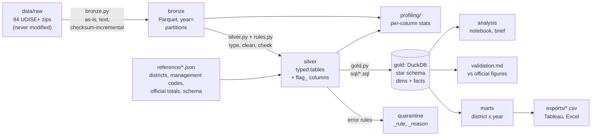

# Rajasthan School Education Insights (UDISE+)


A data pipeline and analysis of school infrastructure, teachers and enrolment in all
41 districts of Rajasthan, built from UDISE+ school-level microdata for 2024-25 and 2025-26.

**Core question:** Which districts are falling behind on school infrastructure and
teachers, and is that linked to girls staying in secondary school?

Two parts:
1. **Data engineering:** an ELT pipeline (raw zips -> bronze -> silver -> gold), with profiling,
   quality rules and quarantine, a DuckDB star schema with an SCD Type 2 school dimension,
   SQL data marts, validation against official figures, tests and CI.
2. **Analysis:** district rankings, girls' secondary enrolment, a school-level regression and
   year-on-year changes, read from the gold marts (`notebooks/`, `docs/policy_brief.md`).

## Architecture



| Layer | What it holds | Last full run |
|---|---|---|
| raw | 94 zips as downloaded from the portal (CSV inside) | 30 MB |
| bronze | one Parquet file per zip, every value as text + load metadata (`_source_file`, `_source_row`, `_run_id`, ...) | 1,720,687 rows, 31.7 MB |
| silver | 5 typed, standardised tables; rows failing an error rule go to quarantine, warnings become `flag_<rule>` columns | 1,707,127 rows; 13,560 quarantined |
| gold | DuckDB star schema: 7 dimensions, 3 facts, 1 intermediate, 2 marts; 33 SQL data tests | `fact_enrolment` 6,403,516 rows |

Every bronze row ends up in silver or in quarantine (checked on every run). All 8 published
2024-25 indicators (schools 1,06,302; teachers 7,92,265; enrolment 1,63,64,187; ...) are
reproduced exactly from gold (`reports/validation.md`).

## How to run

Windows PowerShell, Python 3.13:

```powershell
pip install -r requirements.txt
python run_pipeline.py                 # whole pipeline; unchanged zips are skipped in bronze
python run_pipeline.py --full-refresh  # reload every zip into bronze
python run_pipeline.py --sample        # whole pipeline on synthetic data (outputs in data/sample/)
python -m pytest                       # tests (synthetic data; real-data checks run only if gold exists)
python scripts/benchmark.py            # raw CSV vs bronze vs gold timings -> reports/benchmark.md
python scripts/make_data_dictionary.py # docs/data_dictionary.md from the gold database
python -m pipeline.rules               # docs/quality_rules.md from pipeline/rules.py
python -m analysis.run                 # analysis: figures, tables, Tableau CSVs, Excel workbook
python scripts/make_brief_pdf.py       # docs/policy_brief.md -> two-page PDF (uses Microsoft Edge)
```

The real data is not in this repository (see below). To run on it, download the files from the
UDISE+ Data Sharing Portal and place them in `data/raw/<year>/` with their original names
(e.g. `data/raw/2024-25/facility_data_RAJASTHAN_2024-25.zip`). Do not unzip them. New districts
or years need no code changes. Without the real data, `--sample` runs every stage on
synthetic files; CI does exactly that on every push.

## Outputs

| Output | What | In git? |
|---|---|---|
| `data/gold/exports/mart_district_year.csv`, `mart_district_year_management.csv` | district summaries for Tableau / Excel | yes (district aggregates) |
| `data/gold/exports/tableau_district_indicators.csv` (+ `_long.csv`) | every indicator by district and year, with pattern groups and ranks, for the Tableau dashboard | yes |
| `excel/rajasthan_udise_district_summary.xlsx` | summary sheets and a Data table for PivotTables | yes |
| `notebooks/analysis.ipynb`, `reports/figures/`, `reports/analysis/` | the analysis, its charts and district-level result tables | yes |
| `reports/validation.md` | gold vs official UDISE+ figures | yes |
| `reports/profiling/` | per-column profile of every bronze and silver table; `README.md` lists the problems | yes |
| `reports/qa_report.md` | automated QA report (coverage, schema drift, logic checks, district moves) | yes |
| `reports/benchmark.md` | query timings: raw CSV vs bronze Parquet vs gold | yes |
| `reports/run_manifest.json` | what the last run did: files and checksums, rows per stage, rules, timings | yes |
| `data/bronze/`, `data/silver/`, `data/quarantine/`, `data/gold/udise.duckdb`, `data/gold/parquet/` | the data layers | no (school-level) |

## Documentation

- **`docs/policy_brief.pdf`** (source: `policy_brief.md`): two-page brief for funders and NGOs,
  three findings with charts. `docs/resume_bullets.md`: project bullets with real numbers.

- `docs/design_decisions.md`: why ELT, a star schema, Parquet by year, DuckDB, SCD2,
  synthetic data in CI, and how the management codes were validated.
- `docs/data_dictionary.md`: every gold table and column (generated from the database).
- `docs/quality_rules.md`: every quality rule (generated from `pipeline/rules.py`).
- `DATA_QUALITY_LOG.md`: every data issue found and the decision taken.
- `docs/PLAN.md`: the work plan.

## Repository layout

```
run_pipeline.py        one command for the whole pipeline (--sample, --full-refresh)
pipeline/
  config.py            paths and code mappings; loads reference/*.json
  ingest.py            finds raw zips and reads the CSV inside each, in place
  bronze.py            raw -> bronze Parquet (as-is, incremental by SHA-256)
  silver.py            bronze -> typed, cleaned silver tables; quarantine
  rules.py             quality rules as data (errors quarantine, warnings flag)
  profiling.py         per-column profiles and invalid-code checks per layer
  gold.py              runs sql/*.sql into DuckDB, runs sql/tests/, exports
  validation.py        gold vs official figures (sql/validation/)
  build.py, checks.py  pandas school-year table and the QA report
sql/                   star schema and marts (numbered, run in order), tests/, validation/
reference/             districts, management codes, official totals, schema (JSON)
scripts/               sample data, benchmark, data dictionary, schema extraction, downloader
tests/                 pytest (synthetic data only); regression/ = frozen pandas output
.github/workflows/     CI: tests + pipeline on sample data
```

## Data source, terms and ethics

**Source: UDISE+, Ministry of Education, Government of India** (UDISE+ Data Sharing Portal,
microdata.udiseplus.gov.in). Schemas: `docs/DSP_Schema_2024-25.pdf`, `docs/DSP_Schema_2025-26.pdf`.

The portal's terms say the data must not be redistributed, the source must be acknowledged, and
schools must not be re-identified. So this repository never contains raw, bronze, silver,
school-level or database files; tests and CI use synthetic data generated by
`scripts/make_sample_data.py`; reports never print school codes; only district-level aggregates
are published.

- School codes are pseudonymised; the data has no personal information about students or teachers.
- UDISE+ is self-reported by schools and verified by block and district officials, so figures can
  contain reporting errors (see `DATA_QUALITY_LOG.md`).
- Relationships found in the analysis are correlations, not causal effects.
