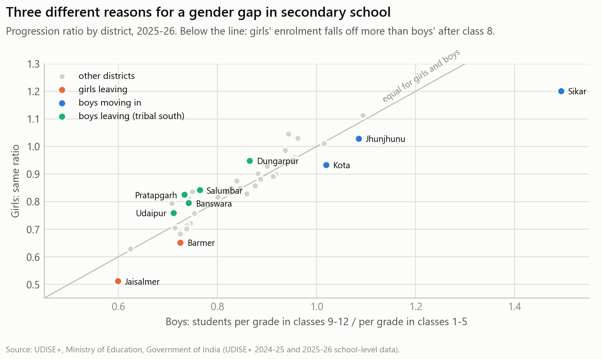
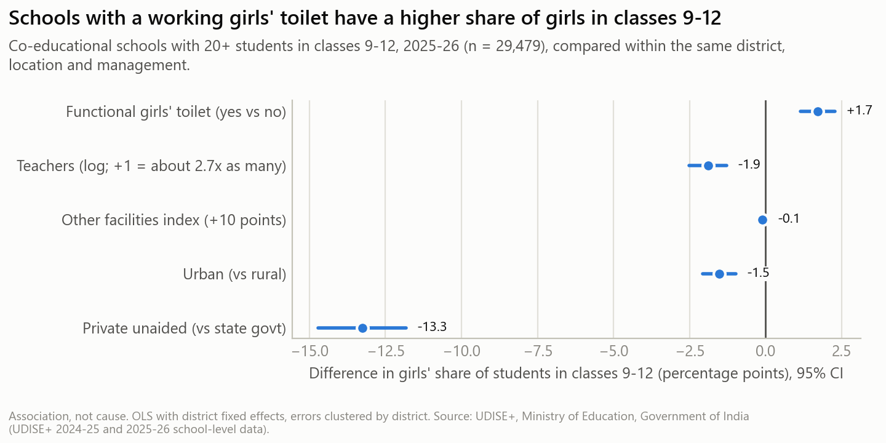
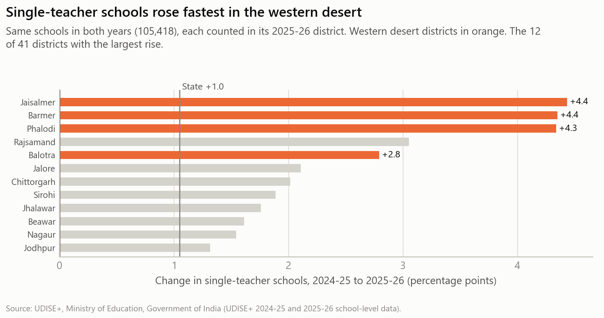

# Keeping girls in secondary school in Rajasthan: three findings for funders and NGOs

*Policy brief, October 2026. Based on UDISE+ school-level data for all 41 districts, 2024-25 and 2025-26.*

**At a glance (2025-26).** Rajasthan has 1,06,167 schools with students in classes 1-12, 1.50 crore
students and 7.93 lakh teachers (18.9 students per teacher). 6.7% of schools have a single teacher.
The tribal-majority south is furthest behind: Banswara, Salumbar and Pratapgarh have the three weakest
infrastructure scores in the state (index 64-68 against a state average of 80), and with Dungarpur they
are four of the five districts with the most single-teacher schools (up to 19.9% in Pratapgarh).

## 1. One gender gap, three different problems

In 17 of the 41 districts, girls make up a smaller share of students in classes 9-12 than in classes
1-5; in the other 24, a larger one. The size and sign of this gap hide three different situations:

- **Girls are leaving** in **Jaisalmer and Barmer**. For every girl per grade in classes 1-5,
  Jaisalmer has only 0.51 per grade in classes 9-12, the lowest in the state (boys: 0.60).
- **Boys are arriving** in **Sikar, Kota and Jhunjhunu**. Sikar has 1.49 boys per grade in classes 9-12
  for every boy per grade in classes 1-5: boys come from elsewhere to these coaching hubs. Girls' share
  falls because boys are added, not because girls leave.
- **Boys are leaving** in the **tribal south** (Banswara, Dungarpur, Pratapgarh, Salumbar, Udaipur), where
  girls' share *rises* after class 8.

**So what.** A district's gender gap alone is a poor targeting tool. Girls' transition programmes
(secondary schools within reach, transport, hostels, community outreach) belong in Jaisalmer and Barmer.
In Sikar and Kota the gap reflects migration *into* the district, not a girls' dropout crisis. In the
tribal south, the priority is boys' retention, alongside the infrastructure and teacher gaps above.

## 2. Girls' toilets and government schools go with more girls in classes 9-12

We compared 29,479 co-educational schools with classes 9-12, each only with schools in the **same
district**, location and type of management:

- Schools with a **functional girls' toilet** have a girls' share about **1.7 percentage points higher**
  (95% confidence interval: 1.2 to 2.3). Other facilities show no link once the toilet is accounted for.
- **Private unaided schools** have a girls' share **13 points lower** than state-government schools. In
  all 41 districts, girls' share drops more between primary and senior classes in non-government
  schools than in government schools; government schools teach 61.5% of all girls in classes 9-12.

**So what.** 2,420 of the 34,024 schools with classes 9-12 still lack a functional girls' toilet, and
1,08,636 girls study in them. Making those toilets work (not only building them, but maintaining them)
is a concrete, countable target. Because government schools carry most girls through secondary school,
strengthening them is the main channel for girls' secondary education. These are associations: a school
may have a toilet *because* it has more girls. A funded pilot with a before-and-after comparison would
show how much of the link is causal.

## 3. Teachers are thinning out where girls already drop out most

Comparing the **same 1,05,418 schools** in both years (so new schools, closures and the 180 schools
moved from Alwar to Kotputli-Behror do not distort the picture), the share of single-teacher schools rose
by 1.0 point state-wide but by **4.4 points in Jaisalmer and Barmer, 4.3 in Phalodi and 2.8 in Balotra**.
In Jaisalmer it went from 12.3% to 16.7% in one year. Jaisalmer, Barmer and Balotra each lost 2.6-3.5% of
the teachers in these same schools, while the median district saw no change.

**So what.** The western desert combines the largest loss of girls relative to boys after class 8
(Jaisalmer, Barmer) with a fast-worsening teacher supply. Teacher deployment there deserves early attention from the state, and NGOs running
learning or teaching-assistant programmes can prioritise single-teacher schools in these four districts.
The data shows where teachers were lost, not why (transfers, retirements or vacancies); district
education offices can confirm the cause.

---

**Method and caveats.** Data: UDISE+ school-level files (profile, facility, teacher, enrolment) for all
41 districts, processed through a tested pipeline; the 2024-25 state totals match the officially
published figures exactly (schools, teachers, enrolment, single-teacher and zero-enrolment schools,
government schools). UDISE+ is self-reported by schools. All findings are correlations, not causal
effects. Full analysis: `notebooks/analysis.ipynb`; data notes: `DATA_QUALITY_LOG.md`.

*Source: UDISE+, Ministry of Education, Government of India.*
